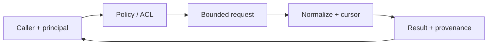

# brain

CLI für das Firmen-Brain (Landkarte + Zellen). Eine Datei, keine Abhängigkeiten, läuft auf Windows, macOS und Linux.

## Voraussetzungen

| Was | Wofür |
| --- | --- |
| Git ≥ 2.40 (Windows: Git für Windows inkl. Git Bash) | `sync` (pull) und `clone-cell` (Sparse-Checkout) |
| GitHub CLI `gh` (empfohlen) | Workspaces finden und Repos klonen, siehe Setup im brain-Repo |
| optional `qdrantcli`, `sharepointcli` im PATH | `sync` schreibt deren Sicht in `_perspektive.md` |

Betriebssysteme: Windows 10/11, macOS 12+, Linux (amd64/arm64). Keine weiteren Laufzeitabhängigkeiten (ein einzelnes Go-Programm).

## Installation

Vorgebaute Binaries: https://github.com/servas-ai/brain-cli/releases/latest (`brain_<os>_<arch>.zip` bzw. `.tar.gz`, Prüfsummen in `SHA256SUMS`). In einen Ordner im `PATH` legen; die vollständige Anleitung steht im brain-Repo: https://github.com/servas-ai/brain#setup-für-die-harness

## Befehle

- `brain hook stop` – Stop-Hook für Claude Code/Codex/Grok CLI (liest beide Transcript-Formate): blockiert das Beenden einmal (höchstens stündlich), wenn die Sitzung recherchiert oder länger gearbeitet, aber nichts ins Brain geschrieben hat. `brain hook compact` – Erinnerung nach einer Zusammenfassung.
- `brain sync` findet über `gh` neue Workspaces (Topic `brain-cell`) und hängt sie ein (`--no-discover` schaltet das ab).


- `brain update-check` – prüft, ob es neuere Versionen von Framework (`BRAIN_VERSION` im Brain) und Tools gibt; `brain sync` macht das automatisch höchstens einmal am Tag und schreibt Hinweise in `_perspektive.md` (abschalten: `--no-update-check` oder `BRAIN_NO_UPDATE_CHECK=1`).


| Befehl | Was |
| --- | --- |
| `brain sync [--root <dir>] [--no-katalog] [--perspektive <md>] [--no-pull]` | `git pull --ff-only` im Root und in jeder Zelle (`workspaces/*/`, `personal/`; Fehler nur Warnung), dann `_kinder.md`, `_workspaces.md`, `_katalog/`, `_perspektive.md` neu erzeugen |
| `brain clone-cell <git-url> [--name <slug>]` | Workspace-Zelle nach `workspaces/<slug>` klonen, per Sparse-Checkout ohne `AGENTS.md`, `CLAUDE.md`, `.claude/`, `.codex/` |
| `brain check [--root <dir>]` | Pflichtfelder im Frontmatter, max. 40 Kinder, keine Harness-Dateien in Zellen, `superseded_by` bei `superseded`; Exit 1 bei Verstößen |
| `brain doctor` | git, `core.longpaths` (Windows), OneDrive-Pfad, `qdrantcli`/`sharepointcli`, `.ignore` |
| `brain login [--url <forge-url>] [--no-open]` | Forge-Brain: Token-Seite öffnen, Token von stdin lesen, prüfen und mit `git credential approve` ablegen (ohne `credential.helper` vorher `credential.helper store`) |
| `brain version` | Version |

### Forge-Brain (Forgejo statt GitHub)

Liegt das Brain auf einer eigenen Forgejo-Instanz, steht im Root `.brain/forge.yml`:

```yaml
typ: forgejo
url: https://git.example.com:8443
org: brain
```

Dann findet `brain sync` die Workspaces über `GET /api/v1/orgs/<org>/repos` (seitenweise, Topic `brain-cell`) mit dem Token aus `git credential fill` (abgelegt mit `brain login`); `gh` wird nicht gebraucht, die Update-Prüfung gegen GitHub ist aus. Ohne die Datei bleibt alles wie bisher.

Root: `--root` oder ab dem aktuellen Verzeichnis nach oben bis zur ersten `AGENTS.md`.

`_perspektive.md` nimmt `--perspektive` bzw. `<root>/.brain/perspektive.md` und hängt, falls im PATH, die Ausgabe von `qdrantcli collections` und `sharepointcli whoami` an (10 s Timeout).

## Bauen

```sh
go vet ./... && ./build.sh          # VERSION=0.1.0 Standard
```

Ergebnis in `dist/`: `brain_<version>_<os>_<arch>.zip` (Windows) bzw. `.tar.gz`, plus `SHA256SUMS`.
Nur Go-Standardbibliothek, `CGO_ENABLED=0`.

Lizenz: MIT.

---

## 🧭 SERVAS Stack Map

> **servas-ai/brain-cli** · Go client for local perspective and sync. Architecture/ownership guide, not production-acceptance claim.

### ✨ Scope

- **Role:** Go client for local perspective and sync.
- **Boundary:** this repository owns only its documented component; other services remain their own source of truth.
- **Security:** least privilege, explicit principal/tenant scope, no secrets in Git/prompts, and read-only reconciliation for uncertain effects.
- **Release:** pin source SHA and distinguish unit/synthetic tests from live acceptance.

### 🗺️ System diagram



### 🖼️ Screenshots

No screenshot image is present in the README at the reviewed revision. Capture a real UI screenshot from a pinned, tested build before adding one; do not use a mockup as runtime evidence.

### ✅ Readiness checklist

- [ ] Source and deployed revision recorded.
- [ ] Permissions and tenant/company scope verified.
- [ ] Failure, retry, revoke and restore tested.
- [ ] Runtime evidence linked; unit tests alone are not product acceptance.
- [ ] UI screenshots, if relevant, captured from the actual tested build.

### 🔗 Integration references

- [Unified SERVAS stack](https://github.com/Martin-Hausleitner/hans/blob/3cfe8247af2df90f8c7173251d7cf2cf9a7a29ff/sources/transcripts/meetings/2026-10-24-kira-servas-review/SERVAS-GESAMTSTACK-MATRIX-MACRO-PAPERCLIP-HANS.md)
- [WorkOS execution plan R3.1](https://github.com/Martin-Hausleitner/hans/blob/3cf6690f0c7c0f829f81a2c4f54e3463444a2a34/sources/transcripts/meetings/2026-10-24-kira-servas-review/repo-review-r2/EXECUTION-PLAN-R3.md)

*Visual README overlay for review. This section does not imply the component is live, merged or accepted.*
